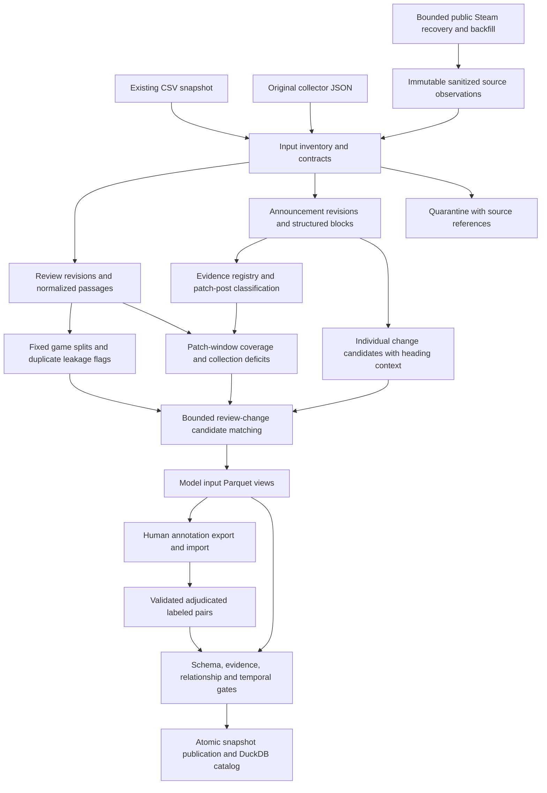

# Steam data processing pipeline

This pipeline prepares versioned, evidence-linked data for model ingestion. The existing `profile`, `quality`, and `preprocess` commands remain available for the original CSV snapshot. The new pipeline adds recovered source observations, structured announcements, change candidates, review/change candidates, and model input contracts.

## Run the whole workflow

From `Game-review/`, use Python 3.11+ and uv:

```bash
uv sync --locked --all-extras
uv run --all-extras steam-insights prepare-data --online
```

`--online` enables bounded public Steam requests. It recovers announcement source content, prepares a collection plan, backfills insufficient historical review periods, builds the dataset, validates publication, generates reports, and exports a development annotation queue. The default shared HTTP budget is 60 requests, including retries. Repeating the command resumes cached/paginated collection and reuses unchanged dataset snapshots. Per-game/per-window page caps apply to each invocation. A page cap does not mean collection is complete. Fully exhausted sparse windows stay in the report as insufficient but stop blocking collection of other patches; `--refresh` revisits them.

To process only the inputs already on this machine:

```bash
uv run --all-extras steam-insights prepare-data
```

The command prints the dataset, quality report, annotation queue, and orchestration journal paths. A completed processing run can still report insufficient source coverage and missing labels. Human annotation files are never fabricated.

## Data flow



## Implementation stages and rationale

| Stage | Implementation | Purpose |
| --- | --- | --- |
| Inventory/import | `pipeline/ingestion.py`, `settings.py` | Read BOM-safe string IDs; fingerprint input files; import CSV, collector JSON and recovered observations; exclude overlapping balanced reviews from the canonical population. |
| Review preparation | `pipeline/reviews.py` | Preserve original text, normalize conservatively, validate values and timestamps, retain revisions, create bounded passages and independent language/duplicate inspection flags. |
| Document parsing | `pipeline/documents.py` | Parse HTML and Steam BBCode, including headings, nested lists, tables, image markup and explicit list closers; preserve canonical offsets and outgoing links. |
| Verification | `pipeline/verification.py`, `announcements.py` | Separate post type, verification method, legacy assertions, release claims, actual release time, platform and branch. Require exact evidence for reviewed decisions. |
| Changes | `extract_changes` in `documents.py` | Extract structural fragments with title/heading context, numerical before/after hints and ambiguity flags. These remain candidates, including when splitting a complex paragraph is uncertain. |
| Splits and relationships | `pipeline/datasets.py` | Allocate games deterministically; flag duplicate families across splits; create observational windows and lexical candidate pairs under task-specific time rules. |
| Human labels | `pipeline/annotations.py` | Validate label enums, human provenance, exact evidence spans and explicit adjudication; preserve disagreement and superseded decisions. |
| Storage | `pipeline/storage.py` | Explicit Arrow schemas, Parquet/Zstandard, stable ordering, row-group statistics, rebuildable DuckDB views. |
| Publication | `pipeline/runner.py`, `checks.py` | Immutable dataset IDs, row accounting, checksums, evidence and relationship gates, staging directory and atomic publication pointer. |
| Operator workflow | `pipeline/orchestration.py`, `commands.py` | Resumable collection, one-command preparation, journal, report refresh and annotation queue. |

The detailed contracts are in [data_dictionary.md](data_dictionary.md). Consequential defaults and their rationale are recorded in [the assumption ledger](../implement-stage/data-pipeline/ASSUMPTIONS.md).

## Storage and reproducibility

```text
data/raw/pipeline_recovery/        Ignored API observations, response cache, cursors and collection reports
data/annotations/patch_verification.jsonl  Audited post-type decisions with exact source evidence
data/annotations/labels.jsonl      Accepted human annotations, created by import (ignored)
data/annotations/queues/           Dataset-specific annotation queues (ignored)
data/datasets/work/                Rebuildable independent-stage outputs and language cache (ignored)
data/datasets/snapshots/<id>/      Published immutable Parquet dataset, manifest, report and catalog
data/datasets/latest.json          Atomic pointer to the current published snapshot
data/datasets/orchestration.json   Last workflow's steps, outcomes and resume diagnostics
reports/data_quality/pipeline/     Aggregate report and supporting CSV/JSON copies
```

The snapshot ID covers source files, annotation/verification inputs, configuration, implementation files and locked dependencies. Each Parquet table has a hash, row count and Arrow contract in `manifest.json`. A build rejects input changes detected during processing. A failed build leaves the previous published pointer intact. Operational collection report timestamps/request counts do not change dataset identity; completed exact-bound query evidence does. Run timestamps are operational metadata, not model features.

Parquet uses Zstandard level 3, 65,536-row groups, and sorted records. The current corpus is small enough for compact per-table files; per-game partitions would produce many tiny files. DuckDB reads the authoritative Parquet tables through views and supports selection/filter pushdown. The catalog stores absolute file paths and can be rebuilt after relocating a snapshot; it is not a second authoritative copy of the data.

Source snapshots and datasets are ignored in Git. Preserve them alongside their manifests when moving machines; manifests alone do not reconstruct unavailable source observations. The layout can later be tracked with DVC/object storage without changing model contracts.

## Review semantics

- `reviews` selects the latest observed revision by Steam update time; `review_revisions` preserves distinct observed text/vote revisions. Repeated observations have separate source references and explicit accounting.
- Original text is preserved verbatim. Canonical text applies NFC and whitespace normalization and preserves negation, numbers, versions, punctuation and emoji. Offsets address this canonical text, using zero-based Python Unicode character indices and exclusive ends.
- Text eligibility defaults to English source metadata and at least ten Unicode word runs. Short/empty reviews remain in recommendation statistics. An independently seeded language detector is an inspection warning, not an automatic deletion policy.
- IDs remain strings where Steam uses uint64. Optional metadata is nullable and explicit booleans are parsed as values.
- Exact duplicate text and likely near-duplicate families do not remove votes or merge users. Cross-split families are excluded from supervised pair exports. Near-duplicate inspection is approximate and reports bucket saturation.
- Recommendation, lifetime playtime and refund/purchase metadata are available for analytics; they are excluded from the model text input whitelist. Recommendation is not aspect sentiment.

## Announcement and patch semantics

An announcement can be an update, development post, promotion, event or unknown type. Candidate classification is retained separately from source confirmation. A patch-note post can contain planned changes, known issues or workarounds alongside released-fix claims. Status hints use the title and inherited headings. Conflicting announcement revisions at the same observation time and structural-quality tier fail publication rather than choosing an arbitrary hash order.

Automatic source confirmation requires recovered content from the official developer announcement feed plus explicit patch/update evidence. Publisher categories are useful when available; the documented news endpoint does not guarantee them. The original ten hard-coded manual flags remain `legacy_manual_flag`; they never silently become new human labels. Curated `source_review` decisions are distinguished from human verification.

`publication_utc` is the post timestamp. `release_utc` requires a supported explicit timestamp or reviewed evidence. Otherwise `anchor_basis=publication_proxy`. A verified post type does not establish that a build was deployed to every platform or that a claimed fix worked. Unknown review platform/branch remains unknown.

Original markup can be imported from the collection machine or retrieved from Steam. A current re-fetch creates a new observation; it does not reconstruct the announcement's historical state. Remaining flattened posts retain degraded-source flags. Outgoing changelog references are preserved in `announcement_links`; external domains are not automatically assumed to be official or crawled.

## Windows and candidate matching

The default pre interval is `[anchor - 14 days, anchor)` and the post interval is `[anchor, anchor + 14 days)`. Windows expose all-review and text-eligible counts, active UTC dates, edited-review counts, recommendation shares, overlaps, sample deficits and collection status. Coverage screens are descriptive, not causal or statistical-power guarantees.

A window passes the default screen with at least 30 eligible reviews on at least seven UTC dates per side plus coverage evidence. Evidence is either observed bounds spanning the whole window or stronger, fully exhausted dated API queries on both sides. A stronger count tier requires 100 eligible reviews per side. Publication proxies, overlapping posts and unknown scope remain visible even when the screen passes.

Candidate matching uses a bounded lexical shortlist with at least two informative shared terms, at most five changes per review/task, and stable tie-breaking. It has two different temporal contracts:

| Task | Allowed direction |
| --- | --- |
| `post_patch_feedback` | A published patch post and its event anchor precede the review by less than 14 days. |
| `retrospective_complaint_resolution` | A change in a subsequent announcement occurs within 90 days after the review. This is explicitly retrospective. |

These candidates are not relevance labels and do not assign every review to a patch. Review-only inputs retain eligible passages even when no candidate is retrieved. Current source content and edited reviews do not prove historical information availability.

## Splits and model loading

The current 30-game corpus uses seed 42 and 8 training, 2 validation and 20 held-out games, retaining the proposal's ten development games. All revisions and derived examples inherit their game's split. Future tuning and learned preprocessing must use development/training data; held-out annotations do not select rules or thresholds.

```python
from steam_insights.pipeline.settings import load_pipeline_config
from steam_insights.pipeline.loader import latest_dataset, iter_model_batches

config = load_pipeline_config()
dataset = latest_dataset(config)
for batch in iter_model_batches(dataset, kind="pairs", split="train", batch_size=512):
    records = batch.to_pylist()  # Text/context and IDs, ready for a chosen tokenizer.
```

Use `kind="reviews"` for passages or `kind="changes"` for changes. Use `labeled=True` for accepted supervised pairs. The latter is empty until human annotations are imported. Model-specific tokenization and token limits belong to the loader/model integration; full source text is retained so it can be re-windowed without data loss.

Run `uv run --all-extras python examples/explore_dataset.py` for aggregate DuckDB queries, or `examples/load_model_inputs.py` for a batch-loading example. Notebook `03_pipeline_duckdb.ipynb` provides the corresponding walkthrough.

## Annotation handoff

```bash
uv run --all-extras steam-insights annotations-export --sample-size 100
# Complete the printed JSONL queue, using the annotation guide.
uv run --all-extras steam-insights annotations-import --input path/to/completed.jsonl
uv run --all-extras steam-insights prepare-data
```

Default queues include development games only, are versioned by dataset ID, and preserve existing files so reruns cannot overwrite human work. Explicit `--split test`/`--split all` supports separate evaluation annotation. Queue records include canonical review/announcement text and exact coordinate information. See [the annotation guide](../data/annotations/README.md).

Only consistent active adjudicated human labels enter `labeled_pairs`. An explicit `supersedes` list resolves older decisions; conflicting adjudications remain excluded. Unknown/stale candidate IDs or mismatched evidence fail import. Source refreshes can change revisions/candidate IDs, so freeze the intended dataset during annotation and inspect stale-label failures rather than transferring labels automatically.

## Independent commands and recovery

```bash
uv run --all-extras steam-insights pipeline --stage inventory
uv run --all-extras steam-insights pipeline --stage reviews
uv run --all-extras steam-insights recover-sources --max-requests 60
uv run --all-extras steam-insights pipeline --stage announcements
uv run --all-extras steam-insights backfill-reviews --max-requests 60
uv run --all-extras steam-insights pipeline
uv run --all-extras steam-insights pipeline-validate
```

Small wrappers are under `scripts/data/`. Prefer `prepare-data --online` for the full ordered workflow; it shares one request budget across collection stages. `--refresh` explicitly re-fetches selected targets. Network responses are cached, review authors are pseudonymized before persistence, and HTTP 429 cooldowns are persisted. Collection records exhaustion, page/request caps, unavailable targets and future periods separately.

An exclusive directory lock prevents simultaneous pipeline writers. After an interrupted process, inspect `data/datasets/.build.lock/owner.json` and the orchestration journal, ensure the writer is stopped, and remove the stale lock directory before rerunning. Independent stage outputs are work files; model consumers should resolve the published `latest.json` pointer.

## Validation and data still needed

```bash
uv run --all-extras python -m unittest discover -s tests -v
uv run --all-extras ruff check
uv run --all-extras steam-insights pipeline-validate
```

Publication checks actual Parquet schemas/hashes, identifiers, source row accounting, foreign keys, exact evidence spans, split allocation, temporal candidate rules and supervised duplicate leakage. SQL date arithmetic explicitly uses UTC, including across daylight-saving transitions. Tests include invalid-record quarantine, failed-publication recovery, model-loading contracts and ambiguous heading context.

The report identifies remaining markup recovery, review-window deficits, uncertain releases/scopes and missing labels. Current inputs support inference/annotation preparation; supervised readiness requires real annotated examples and a separate assessment of label volume, class coverage and agreement. More reviews should be collected around selected patch events rather than by increasing arbitrary per-game quotas.

## Primary references behind the design

- [Apache Arrow Parquet IO](https://arrow.apache.org/docs/python/parquet.html): schemas, compression, row groups and datasets.
- [DuckDB Parquet guidance](https://duckdb.org/docs/stable/data/parquet/tips) and [partitioned writes](https://duckdb.org/docs/stable/data/partitioning/partitioned_writes): filtered reads, sorting and avoiding tiny partitions.
- [Steam review service](https://partner.steamgames.com/doc/webapi/IUserReviewsService): documented current review endpoint, creation-date bounds, pagination and rate limiting.
- [Steam news service](https://partner.steamgames.com/doc/webapi/ISteamNews): full post contents and dated news pagination.
- [Steam patch-note categories](https://partner.steamgames.com/doc/marketing/event_tools/type_patchnotes): update types and build association. [Build history](https://partner.steamgames.com/doc/webapi/ISteamApps) requires the app owner's publisher key.
- [Scikit-learn common pitfalls](https://scikit-learn.org/stable/common_pitfalls.html): split isolation and training-only learned transformations.
