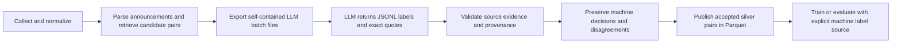

# LLM-only labeling and model ingestion

Human annotation is optional. The pipeline can use evidence-backed labels produced entirely by an LLM. Machine labels are called **silver** labels and remain separate from the optional human **gold** tables. You can train on silver data without obtaining any human labels.

## Where this fits



No human adjudication is required on this route. A person still transfers files into/out of their chosen LLM interface. These commands make no model API calls and incur no model API charges. A provider-specific automatic runner can later consume `requests.jsonl` and `response.schema.json` without changing the label/import contracts.

## 1. Prepare and export

From `Game-review/`:

```bash
uv run --all-extras steam-insights prepare-data
```

This now exports a dataset-specific LLM job and prints `llm_annotation_job`. Existing jobs are preserved. For a shorter custom pilot with an easy-to-type path:

```bash
uv run --all-extras steam-insights llm-annotations-export \
  --sample-size 20 --batch-size 5 \
  --output data/annotations/llm_jobs/pilot
```

Use a fresh output directory if that name already exists. Export samples development games by default; `--split test` supports a separate frozen evaluation job. Sampling spreads examples across game/task/split groups rather than claiming to represent their natural frequency. Cross-split duplicate families are excluded.

The directory contains:

| File | Purpose |
| --- | --- |
| `batch-0001.md`, etc. | Each file contains the full instructions, output schema and source data; give one file to the LLM per conversation. |
| `instructions.md` | Versioned labeling rules, including untrusted-source handling. |
| `requests.jsonl` | Machine-readable task inputs for a future API runner. |
| `response.schema.json` | Structured response contract. |
| `manifest.json` | Frozen dataset, candidate membership, prompt version and batch inventory. |

## Patch-scoped retrieval pilot

For a focused audit of one patch, use `--patch-id`. With this option, export spreads examples across change/task/split groups and chooses the highest lexical-score candidates within each group first. `--exclude-annotated` omits candidate IDs already present in the snapshot's machine annotation table, which is useful when continuing a labeling pass after a rebuild.

```bash
uv run --all-extras steam-insights llm-annotations-export \
  --patch-id 9593c96b043f323204b6db3437497a9b4972e5986d637dd7e21ce7b908946839 \
  --sample-size 200 --split train --exclude-annotated \
  --output data/annotations/llm_jobs/sot-381-pilot
```

Patch jobs include `retrieval_audit.csv`, which records the lexical candidate pool, lexical rank within each change/task, and which pairs were sampled or already labeled. The sidecar is not shown to the labeling model. It audits only pairs created by the current lexical retriever; high relevance among surfaced pairs says nothing about pairs the retriever missed. The sampling is stratified and rank-prioritized, so relevance rates are descriptive rather than unbiased precision estimates. After responses arrive, summarize them with:

```bash
python scripts/data/report_patch_pilot.py \
  --job data/annotations/llm_jobs/sot-381-pilot \
  --responses data/annotations/llm_jobs/sot-381-pilot/responses
```

The generated `retrieval_audit_report.md` summarizes response coverage and relevance by task and lexical rank. It does not claim recall or patch causality.

After a full rowwise contextual re-review, pass that review's response file and provenance to the report command. Set `--rowwise-context-audited` only when every response was checked against the complete review and its announcement context:

```bash
python scripts/data/report_patch_pilot.py \
  --job data/annotations/llm_jobs/sot-381-pilot \
  --responses data/annotations/llm_jobs/sot-381-pilot/rowwise-audit/responses-0001.jsonl \
  --rowwise-context-audited --audit-model GPT-6 \
  --audit-run-id codex-gpt6-sot381-row-audit-2026-10-18
```

The rowwise flag documents that review occurred; it does not make an LLM pass independent or human-adjudicated. The report must keep those labels identified as silver.

Each example includes its task direction, review, selected passage, specific change, title, headings and full canonical announcement. Recommendation votes and rule-generated labels are omitted. The default limits are ten examples and 100,000 source JSON characters per batch. These are file-transport heuristics, not token limits. An oversized individual example is flagged and preserved intact rather than losing evidence through truncation.

## 2. Give the Markdown files to an LLM

Attach or paste a `batch-*.md` file in a fresh conversation. Ask the model to follow the enclosed instructions and return the JSONL file. Repeat for the remaining batches. Save outputs in a separate `responses/` directory or one combined JSONL file. Do not include instructions, schemas or unrelated files in that response directory.

The model supplies:

- `candidate_id`: unchanged.
- `relevance`: `relevant`, `irrelevant` or `uncertain`.
- `sentiment`: sentiment toward the target change, not the whole game.
- `fix_status`: what the announcement claims, not whether a fix succeeded.
- `review_evidence` and `change_evidence`: exact source quotes in objects such as `{"text":"exact quote"}`; null where appropriate.
- `rationale`: a short explanation.
- `confidence`: self-reported 0–1 confidence, retained for inspection rather than treated as a calibrated probability or automatic quality guarantee.
- `supersedes` (optional): older annotation IDs for this same candidate when this response intentionally corrects a prior decision.

Relevance is decided for the review/change pair, in its task direction. For `post_patch_feedback`, the review must discuss the specific preceding change. For `retrospective_complaint_resolution`, the earlier review must describe the specific problem the later change addresses. A shared game term or broad opinion about bugs, PvP, ships, or the game does not establish relevance. Use `uncertain` when the review and change share a symptom but the source context does not identify the same issue. A `relevant` decision needs an exact quote from both the review and the full announcement. The exported input includes the change, title, headings, and full canonical announcement so the labeler can use surrounding context.

The importer computes character offsets for unique exact quotes. If the same quote appears multiple times, the response must include its zero-based Unicode `start`. Invented/paraphrased quotes fail import. Irrelevant pairs require `not_applicable` sentiment/fix status; relevant pairs require evidence from both sources.

No model choice is hard-coded. Record the actual model/version you used on import; the pipeline stores this as operator-supplied provenance, not verified provider attestation. Do not label machine output as human.

## 3. Import responses

```bash
uv run --all-extras steam-insights llm-annotations-import \
  --job data/annotations/llm_jobs/pilot \
  --input data/annotations/llm_jobs/pilot/responses \
  --model "actual-model-and-version-used" \
  --run-id first-pass
```

`--input` accepts one JSONL/JSON file or a directory of those files. A JSON array or a single enclosing Markdown code fence is also accepted. Partial batches may be imported; the command reports remaining job responses. Re-importing the same answers under the same model/run/job is idempotent. Use a distinct run ID for another model or labeling pass. Responses that change labels in the same run are rejected rather than silently overwritten.

Import checks the frozen snapshot and job membership, allowed labels, exact evidence, confidence range and machine provenance. It adds import time, model, run, job and prompt version, then atomically merges accepted records into `data/annotations/llm_labels.jsonl`. Invalid responses leave the existing label file intact. Import does not write to human `labels.jsonl`.

These checks validate data integrity and provenance; they do not independently verify the semantic relevance judgment. LLM labels remain silver and should be sampled or individually audited against the full source context before using them to claim retrieval precision or tune a threshold.

An optional second model/pass can label the same job without seeing the first model's responses. If active machine decisions disagree, the candidate is preserved for inspection but excluded from silver training data. Agreement is a consistency check, not proof of correctness; one valid pass can produce silver data. A deliberate correction pass can use a distinct run ID and an explicit `supersedes` list of older same-candidate annotation IDs to resolve previous decisions while preserving the full history. No human adjudication is required.

## 4. Rebuild and load machine supervision

```bash
uv run --all-extras steam-insights prepare-data
```

The snapshot adds:

| Table | Meaning |
| --- | --- |
| `llm_annotations.parquet` | All validated machine decisions, exact evidence, provenance, rationale and confidence. |
| `silver_pairs.parquet` | Accepted relevant/irrelevant pairs with machine labels and provenance; uncertain/conflicting decisions and cross-split duplicates excluded. |
| `annotations.parquet`, `labeled_pairs.parquet` | Optional human-only data; remain empty when there are no human annotations. |

```python
from steam_insights.pipeline.loader import iter_model_batches, latest_dataset
from steam_insights.pipeline.settings import load_pipeline_config

dataset = latest_dataset(load_pipeline_config())
for batch in iter_model_batches(
    dataset, labeled=True, label_source="llm", split="train", batch_size=512
):
    records = batch.to_pylist()  # Text, labels and explicit machine provenance.
```

The quality report exposes `silver_training_inputs_available` separately from the older human-specific `supervised_training_ready` flag. Neither flag establishes enough volume, class balance or accuracy; it only indicates the corresponding training rows exist.

## Interpretation and dataset lifetime

Evaluation on LLM-labeled held-out games measures agreement with the labeling process. It does not establish independently verified human accuracy. Keep model/prompt versions fixed for comparisons; avoid presenting the labeling model's own labels as independent evidence of its performance. You can still develop and run the complete system without human annotation.

Labels cover the lexical candidate population, not every possible review/change match. Cases the retriever misses are not measured by candidate-only evaluation. Validation checks source/format consistency and cannot prove semantic correctness, fix effectiveness or patch causality.

Freeze the collection snapshot while labeling. Current review/announcement revisions may differ after online collection; stale candidate IDs fail rather than silently transferring labels. Keep the job directory, imported responses, label file and source snapshot together. These local artifacts are ignored in Git; preserve them in your data backup/versioning system.
